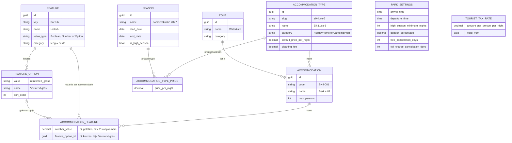

# Datamodel accommodaties, seizoenen en prijzen

Dit document hoort bij US-02 (datamodel en import) en US-05 (prijzen, seizoenen en parkregels).

## Keuzes

**Eén tabel voor huisjes en kampeerplaatsen.** Huisjes en plaatsen worden op dezelfde manier gezocht, geboekt en
beheerd. Een aparte tabel of overerving per categorie levert dubbele code op voor bijna geen winst. De categorie staat
op het type.

**Alle eigenschappen als data (`features`).** Alles wat de export onder `properties` noemt, wordt een feature:
ja/nee-eigenschappen (sauna, laadpaal), getallen (slaapkamers, maximaal aantal huisdieren, maximale voertuiglengte) en
keuzes uit een vaste lijst (ondergrond, schaduw, wifi-bereik). De waarde per accommodatie staat in `accommodation_features`. Huisjes en kampeerplaatsen
hebben bijna geen eigenschappen gemeen, dus als kolommen zou ongeveer de helft altijd leeg zijn. Nu kan de beheerder
eigenschappen per accommodatie aanpassen (US-30) zonder dat er een kolom of migratie bij komt, en toont de website ze
met hun Nederlandse naam. Een "nee" wordt niet opgeslagen: dan bestaat de rij niet.

Keuzes staan in `feature_options` met een vaste waarde (`reinforced_grass`), een Nederlandse naam (`Versterkt gras`) en
een volgorde. Een accommodatie verwijst naar de gekozen optie, dus de database kan alleen een bestaande keuze bevatten.
Het beheerscherm (US-30) bouwt zich op uit `GET /Feature`: een vinkje bij ja/nee, een getalveld bij getallen en een
keuzelijst bij opties, alleen voor features van de eigen categorie.

Eigenschappen waar businessregels op draaien, staan als constante in `FeatureKeys` (bijvoorbeeld `maxPets` voor het
zoeken met huisdieren). Filteren gaat zo:
`accommodation.Features.Any(f => f.Feature.Key == FeatureKeys.MaxPets && f.NumberValue >= aantalHuisdieren)`.
`petsAllowed` en `electricity` uit de export zijn geen feature, omdat ze altijd gelijk zijn aan `maxPets > 0` en
`electricityAmps > 0`. Twee bronnen voor dezelfde waarde kunnen elkaar tegenspreken.

**Zones als eigen tabel.** De opdrachtgever wil zones zelf toevoegen en aanpassen. Een zone hoort bij de camping of
bij de huisjes, nooit bij beide: zo blokkeert een volle camping aan het water nooit een gast die een huisje aan het
water wil. Dezelfde naam mag daarom twee keer bestaan (unieke index op naam en categorie).

**Seizoenen zijn periodes met een eigen prijs.** Het park bepaalt ieder jaar zelf zijn periodes (zomer, kerst,
voorjaarsvakantie, rond Pinksteren). Een nacht in een periode krijgt de prijs van het type in die periode; een nacht
daarbuiten de standaardprijs van het type. Alleen periodes met `is_high_season` vallen onder het minimum aantal nachten.

**Toeristenbelasting met ingangsdatum.** De gemeente wijzigt het tarief soms. Een nieuw tarief is een nieuwe rij, zodat
een bestaande boeking de tarieven van haar eigen nachten houdt.

## Import

`AccommodationSeeder` leest het exportbestand van de opdrachtgever (`Persistence/Seeders/Data/accommodaties.json`,
ingebed in de dll) en vult types, zones, features en de 200 accommodaties met hun waarden. Het soort waarde (ja/nee,
getal of keuze) leest de import uit de JSON zelf; de keuzelijsten met Nederlandse namen staan in de seeder. De import draait alleen op een lege
database; daarna is de database leidend en worden wijzigingen van de beheerder nooit overschreven. Een onbekende
eigenschap in de export stopt de import met een duidelijke melding, zodat er nooit een feature zonder naam op de
website komt.

`ParkConfigurationSeeder` vult daarna de parkregels, het tarief van de toeristenbelasting, testprijzen per type en de
seizoenen voor 2026 en 2027.
